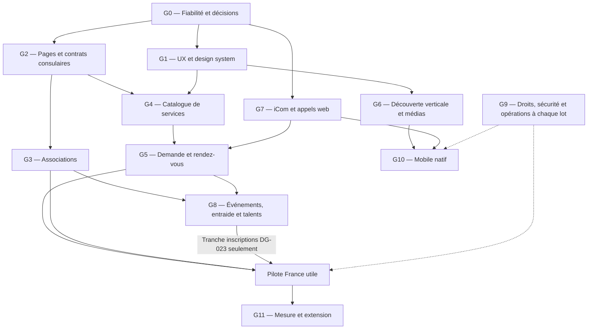
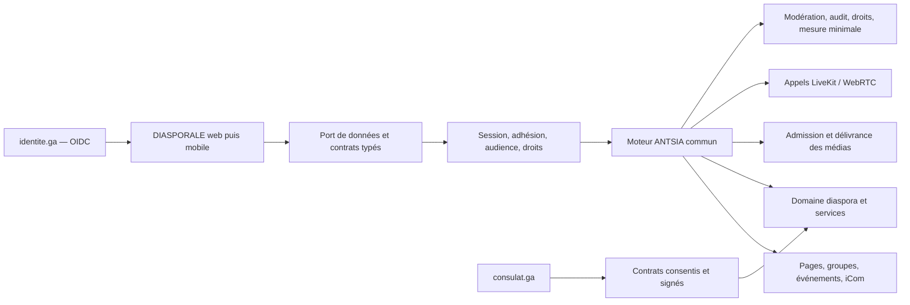
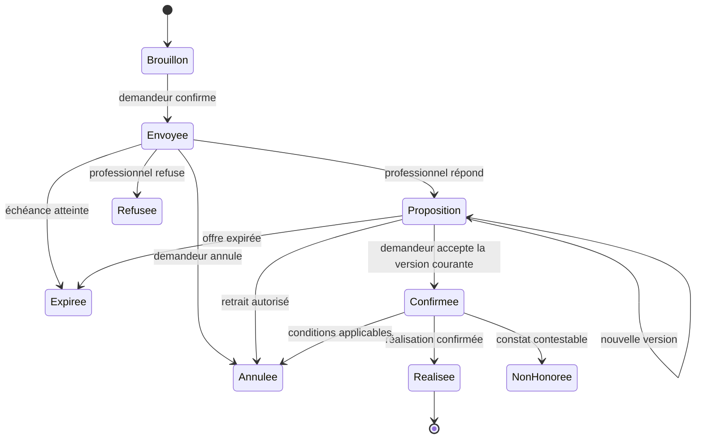

# DIASPORALE — Plan global d’implémentation

Ce plan traduit la demande du 18 octobre 2026 : **défilement inspiré de TikTok, présentation visuelle inspirée d’Instagram, messagerie et appels inspirés de WhatsApp**, au service des associations, des entrepreneurs et des Gabonais de l’étranger.

Il complète les prompts PD0–PD10 existants. Il ne remplace ni les invariants du moteur ANTSIA ni les preuves de recette. Les nouveaux lots `G0–G11` sont des unités de pilotage proposées, pas des fonctionnalités déjà livrées. Les chemins indiqués comme « proposés » restent à créer seulement lors de leur implémentation.

Lire avec l’[étude produit et UX](13_ETUDE_RESEAU_SOCIAL_DIASPORALE.md) et l’[audit des skills](15_AUDIT_SKILLS_DIASPORALE.md). Le [plan historique](01_PLAN_IMPLEMENTATION_PROMPTS_DIASPORALE.md) et la [parité](04_PARITE_SURFACES.md) conservent l’historique des travaux.

> **Reprise d'implémentation du 18 octobre :** DG-003 et une première vague des pages, équipes, adhésions, services, demandes/rendez-vous, droits personnels et découverte verticale sont raccordés dans les sources. Codex a repris le point d'arrêt de Claude et ajouté les avis et réponses DG-016. Les vérifications de la vague combinée restent différées sur instruction du propriétaire ; ces modules ne sont pas déclarés validés. Voir [l'inventaire de la vague](18_EXECUTION_VAGUE_G.md), [DG-003](16_CHOIX_PRIVES_DU_FIL_DG003.md) et [DG-016](19_REPRISE_CLAUDE_AVIS_SERVICES_DG016.md). Les sous-parties restant à construire et les recettes sont distinguées dans ces rapports.

> **Suite DG-010 :** groupe thématique privé lié à l'association, entrée volontaire et événements sous identité de page sont raccordés dans les sources, fournisseurs moteur/démonstration et interface française/anglaise. Les contrôles restent différés. Le [rapport G3](21_GROUPES_EVENEMENTS_ASSOCIATIONS_DG010.md) distingue le mur textuel et les événements simples des extensions iCom, médias, capacités et inscriptions avancées DG-023.

> **Suite DG-023 :** capacité, attente FIFO et retrait, dates limites/rappels J-1, présences QR, galerie collective et export iCal/agenda personnel sont raccordés aux événements associatifs. Les [capacités](22_CAPACITES_LISTES_ATTENTE_EVENEMENTS_DG023.md), [rappels](24_DATES_LIMITES_RAPPELS_EVENEMENTS_DG023.md), [présences](27_PRESENCES_QR_EVENEMENTS_DG023.md), [galerie](28_GALERIE_APRES_EVENEMENTS_DG023.md), [calendrier](29_EXPORT_ICAL_AGENDA_ASSOCIATIF_DG023.md) et [pagination native de l’agenda](30_PAGINATION_AGENDA_PERSONNEL_DG023.md) attendent les contrôles et recettes ; délivrance réelle des médias/rappels et imports tiers restent à prouver. Le nouveau panneau poursuit au-delà des scans200, l’aperçu historique reste borné et l’export reste une copie ponctuelle.

> **Vague H (18/10, soir) :** entraide et missions bénévoles, kit d'arrivée relu et daté, mentorat volontaire (DG-024), talents et emploi (DG-025), guichet de modération par pays (PD6, G9), mesure du pilote et grille de coûts (G11, DG-027) et notifications neutres de la mise en relation (DG-015) sont raccordés dans les sources, avec leurs points d'entrée. Tests écrits, aucun contrôle exécuté, conformément à la consigne du propriétaire. Voir [l'inventaire de la vague H](32_EXECUTION_VAGUE_H.md).

## Sommaire

1. [Résultat à livrer et ordre](#1-résultat-à-livrer-et-ordre)
2. [Architecture et responsabilités](#2-architecture-et-responsabilités)
3. [Modèle de données et contrats](#3-modèle-de-données-et-contrats)
4. [Lots exécutables](#4-lots-exécutables)
5. [Backlog priorisé](#5-backlog-priorisé)
6. [Recette de bout en bout](#6-recette-de-bout-en-bout)
7. [Performance, coûts et exploitation](#7-performance-coûts-et-exploitation)
8. [Organisation, décisions et livraison](#8-organisation-décisions-et-livraison)

## 1. Résultat à livrer et ordre

### 1.1 Les trois résultats utilisateurs prioritaires

1. **Trouver une compétence locale** : rechercher « coiffure, Paris », consulter une offre précise, adresser une demande, obtenir une réponse, convenir d’un rendez-vous, échanger et confirmer le résultat.
2. **Faire vivre une association** : revendiquer sa page, désigner une équipe, accueillir des membres consentants, annoncer une activité, gérer les inscriptions et conserver une mémoire utile.
3. **Découvrir et communiquer facilement** : parcourir des contenus verticaux, consulter photos et portfolios, retrouver une conversation, appeler une personne qui l’accepte.

Le premier pilote utile doit couvrir les deux premiers résultats avec des conversations fiables. La découverte vidéo avancée et les applications natives suivent un calendrier explicite ; elles ne doivent pas retarder indéfiniment le service rendu à la communauté.

### 1.2 Correspondance avec les lots historiques

| Nouveau lot | Résultat | Rattachement | Dépendances de sortie |
|---|---|---|---|
| G0 | État réel, recettes restantes, décisions d’architecture | Clôture PD4, PA5/PA6 | Aucune ; commence en premier |
| G1 | Navigation, composants et accessibilité communs | PD4, charte | G0 pour l’inventaire ; peut préparer les lots suivants |
| G2 | Pages d’organisations et connexion publique à consulat.ga | PD5, PD3 pour l’attestation | G0 ; import réel conditionné au contrat activé |
| G3 | Associations, adhésion et événements simples | PD5 + première tranche PD7 | G2 + gardes G9 applicables |
| G4 | Catalogue de professionnels et recherche de services | Extension explicite de PD8, sur PD5 | G2 + G1 |
| G5 | Demandes, propositions, rendez-vous, avis | PD8 + iCom PD7 | G4 + extension de droits iCom validée |
| G6 | Fil vertical et médias adaptatifs | Extension PD4 + moteur découverte | G0, G1 ; pipeline média sécurisé |
| G7 | Conversations complètes et appels web | PD7 | G0 ; infrastructure et choix de chiffrement |
| G8 | Événements avancés, entraide, talents et emploi | PD7/PD8 | G3/G5 ; ouverture progressive par domaine |
| G9 | Modération, droits, confidentialité, exploitation | PD6, PA5, PA8 et PD10 | Transversal dès G0 ; bloque chaque ouverture concernée |
| G10 | Applications natives iOS/Android | PD9 | Contrats stables G1–G7 ; G9 |
| G11 | Pilote, mesure, montée en charge ; options B2B | PD10 puis D4 distinct | Recettes requises des lots ouverts |

### 1.3 Ordre recommandé



La dépendance G7 → G5 vise d’abord la **conversation de prestation** ; G5 n’attend pas la totalité des appels de groupe. Décomposer G7 en messagerie, appels web et chiffrement permet de conserver cette livraison progressive. Les flèches représentent des dépendances fonctionnelles, pas une autorisation de lancer plusieurs compilations simultanées sur le Mac.

Pour G8, la tranche événements dépend de G3 et peut avancer sans les modules emploi/talents. Le pilote incluant des inscriptions attend cette tranche DG-023 et la preuve de messagerie DG-020 ; il n’attend pas tout G8.

Le pilote de mise en relation peut commencer avant G6 avec les médias déjà éprouvés. En revanche, la version annoncée comme réalisant la combinaison TikTok/Instagram/WhatsApp doit avoir terminé **G6, G7 et les gardes G9**, puis G10 pour revendiquer la qualité d’appels native. Nommer ces deux jalons séparément.

## 2. Architecture et responsabilités

### 2.1 Réutiliser le moteur existant

| Zone | Responsabilité | Règle de travail |
|---|---|---|
| `DIASPORALE/packages/diasporale-domain` | Règles pures diaspora, catégories, transitions propres aux services | Fonctions déterministes, tests de domaine |
| `DIASPORALE/packages/diasporale-features` | Surfaces et port de données, i18n, composants métier | Aucun accès direct à une base externe |
| `DIASPORALE/apps/diasporale_com` | Routes, fournisseurs, adaptation des projections du moteur | Éditer les fichiers réellement servis |
| `ANTSIA/convex/modules/diaspora` | Facettes, hubs, contrats et extensions propres à DIASPORALE | Propriété DIASPORALE coordonnée avec le moteur |
| `ANTSIA/convex/modules/{pages,thematicGroups,events,messaging,calls,...}` | Capacités génériques partagées | Propriété ANTSIA ; noms exacts à suivre dans le dépôt |
| `ANTSIA/packages/social-features` et contrats associés | iCom, albums, stories, appels et surfaces mutualisées | Pas de fork d’iCom pour DIASPORALE |
| `ANTSIA/packages/ui/src/themes/diasporale.css` | Contrat des jetons visuels | Étendre les rôles avec le propriétaire du moteur |
| `GABON_DIPLOMATIE` | Producteur des attestations et objets publics autorisés | Contrats HTTP versionnés ; aucune lecture de sa base depuis ANTSIA |

Les fichiers communs `schema.ts`, registres, catalogue, manifeste de déploiement et dépendances restent modifiés par leur propriétaire ANTSIA. Un contrat partagé est défini avant que les deux applications le consomment.

### 2.2 Architecture cible



### 2.3 Décisions techniques proposées

- Garder Convex comme source métier, les jobs et outbox existants comme mécanisme de reprise ; ne pas introduire un second backend social.
- Ajouter un module générique de services dans ANTSIA **seulement si son contrat sert plusieurs réseaux**. Sinon, commencer dans la tranche `diaspora/services` proposée, avec domaine pur extractible. Cette décision précède le schéma.
- Indexer et paginer dans le réseau autorisé. Un moteur de recherche externe éventuel ne reçoit que la projection admissible et doit être purgé avec la source ; le filtre après recherche ne constitue pas la seule garde.
- Réutiliser LiveKit pour le temps réel. La vidéo publiée et le direct ont des contraintes différentes : ne pas utiliser un appel WebRTC comme stockage de vidéos du fil.
- Évaluer le transcodage managé et le transcodage opéré par le programme sur coût, résidence, effacement, protection des segments et capacité d’exploitation. Aucun fournisseur n’est engagé par ce plan.
- Ne pas promettre le chiffrement de bout en bout des messages à partir du seul chiffrement transport. Une décision spécifique couvre clés, appareils, récupération, pièces jointes et signalements.

## 3. Modèle de données et contrats

### 3.1 Entités à réutiliser ou à ajouter

Les noms nouveaux ci-dessous sont **proposés**, à aligner avec le schéma existant avant codage. Toutes les entités sociales portent `networkId`, les références typées, des dates et une politique d’export/effacement. Les états de modération restent orthogonaux aux états métier.

| Entité | Action | Champs métier minimaux / limites |
|---|---|---|
| `pages`, `pageClaims`, `pageSignatories` | Réutiliser | Type, pays, mandat, droits, état de revendication ; pièces de preuve privées |
| `thematicGroups`, groupes de conversation | Réutiliser | Rattachement à une page, règles, membres consentants ; suivre la capacité moteur |
| `associationMemberships` | Ajouter si non couvert | Page, personne, statut, rôle, dates ; aucun import de la liste consulaire des membres |
| `serviceCategories` | Ajouter | Slug stable, libellés FR/EN, catégorie parente, pays admis, contraintes professionnelles |
| `serviceOffers` | Ajouter | Page professionnelle, titre, description, catégorie, zone, mode présentiel/distant, langue, durée, mode et montant du prix, devise, médias autorisés, état |
| `serviceAvailability` | Ajouter par tranche | Règles hebdomadaires, exceptions, fuseau IANA, ressource/personnel ; ne pas faire passer une préférence pour un créneau garanti |
| `serviceRequests` | Ajouter | Demandeur, offre/version, besoin, fenêtres souhaitées, statut, identifiant d’idempotence ; adresse exacte séparée et restreinte |
| `serviceProposals` | Ajouter | Proposition versionnée, périmètre, montant en unité mineure, devise, conditions, expiration, auteur habilité |
| `serviceBookings` | Ajouter | Proposition acceptée, début/fin UTC, fuseau d’affichage, ressource, statut ; unicité de réservation transactionnelle |
| `serviceReviews` | Ajouter | Rendez-vous éligible, auteur, note et commentaire, statut de modération, droit de réponse ; une évaluation par prestation et auteur |
| `serviceDisputes` | Ajouter sans doublonner la modération | Participants, raison, pièces privées, état ; lien vers un dossier de modération si nécessaire |
| `events`, inscriptions, listes d’attente | Étendre | Capacité, organisateur habilité, fuseau, liste d’attente et jeton de présence non devinable |
| Conversations et messages | Réutiliser et étendre les scopes | Contexte de relation, de groupe ou de prestation ; référence métier, pas de contenu sensible dans les notifications |
| Préférences de découverte | Étendre | Centres d’intérêt explicites, exclusions, mode chronologique, économie de données ; réinitialisation possible |
| Projection de candidats du fil | Réutiliser/étendre | Ordre stable par session, version de classement, curseur opaque ; contrôle courant des droits à la lecture |
| Variantes média et sous-titres | Étendre | Source, renditions, affiche, piste texte, état de traitement ; mêmes règles de révocation que l’original |

Index initiaux à concevoir : `network + country/city + category + status`, `network + providerPage + status`, `network + requester + updatedAt`, `network + booking + reviewer`, `network + resource + startAt`. Choisir les index à partir des requêtes effectives ; éviter de multiplier des combinaisons inutilisées.

### 3.2 Machines d’états



Un désaccord peut ouvrir un dossier depuis plusieurs états ; il ne réécrit pas silencieusement l’historique. Une demande de confirmation restée sans réponse ne devient pas automatiquement une prestation « vérifiée ». Le badge d’avis indique exactement la preuve détenue : rendez-vous confirmé ou réalisation confirmée.

Pour les associations : `requested → accepted | rejected | cancelled`, puis `accepted → left | removed`. Le changement de responsable est une transition distincte, avec mandat et journal. Créer un groupe d’association n’y inscrit personne automatiquement.

### 3.3 Contrats d’API proposés

| Opération | Contrôle essentiel | Résultat attendu |
|---|---|---|
| `searchServiceOffers` | Adhésion lisible, pays, offres publiées, sanctions, blocages | Projection de catalogue + curseur ; aucun contact privé |
| `getServiceOffer` | Même garde, offre encore visible | Fiche et capacités réelles, pas de boutons fondés sur un rôle client |
| `createServiceRequest` | Membre autorisé à écrire, offre disponible, débit, consentement | Demande unique + conversation limitée au contexte |
| `respondToServiceRequest` | Signataire courant de la page, bonne version | Proposition horodatée, sans écraser celle acceptée |
| `acceptServiceProposal` | Bon demandeur, version et échéance, créneau libre | Réservation atomique et notification idempotente |
| `cancelServiceBooking` | Participant autorisé, conditions versionnées | État et motif ; aucune facturation tant que le paiement n’existe pas |
| `submitServiceReview` | Prestation admissible, auteur non propriétaire, unicité | Avis en relecture ou publié suivant la politique |
| `requestAssociationMembership` | Adhésion réseau, page active, débit | Demande ; pas d’accès anticipé au groupe privé |
| `acceptAssociationMembership` | Responsable courant, version | Droit de groupe synchronisé et révocable |
| `getDiscoveryPage` | Filtrage serveur avant classement puis avant projection | Candidats visibles, raison lisible, curseur de session |

Chaque mutation précise ses validateurs, son seau de débit, son audit, ses effets différés, sa clé d’idempotence, sa politique d’effacement et ses erreurs indistinctes. Les mises à jour concurrentes utilisent une version attendue lorsque le métier l’exige.

### 3.4 Deux consentements différents, deux frontières

**Attestation** : une personne demande la vérification consulaire ; le moteur reçoit uniquement le résultat et les métadonnées minimales autorisées. La révocation est prise en charge sans effacer les droits indépendants de cette preuve.

**Objets communautaires publics** : le contrat peut livrer des organisations ou événements déjà publiés. L’import conserve source, licence/autorisation, version, date et statut de retrait. Il ne crée ni personne ni adhésion. Une entreprise importée n’obtient pas automatiquement un propriétaire, des clients, des avis ou un accès à la messagerie.

## 4. Lots exécutables

### G0 — Fermer les incertitudes avant d’étendre

**Livrables** : inventaire daté du code servi, matrice de parité actualisée, décisions sur catalogue/communications, preuves restantes PD4.

- Conserver le travail parallèle d’ANTSIA sur authentification et partage ; attendre leur gel pour une vérification commune unique.
- Terminer la recette des deux photos : publication exacte, objets livrés, lecture par un autre membre, navigation 1/2 et 2/2, retour, rechargement, autorisations et retrait. Une déclaration de publication ne suffit pas à clore cette preuve.
- Conserver la preuve locale vidéo du 18 octobre, avec ses limites : elle ne prouve ni l’audio ni les appels ni la lecture native.
- Réévaluer les réglages de contenu : inverse des publications masquées et des auteurs en sourdine ; façade diaspora avant affichage d’un profil caché.
- Recenser les gardes PA5 déjà existantes plutôt que reconstruire modération, export et effacement.

**Sortie** : aucune recette ouverte présentée comme validée ; prochaine tranche désignée ; coordonnées des propriétaires de chaque fichier partagé.

### G1 — Navigation et design system

**Surfaces** : `app-shell.tsx`, table de routes, composants DIASPORALE, jetons du moteur. Les noms de nouveaux composants sont proposés : `DiscoveryItem`, `ServiceCard`, `ServiceRequestSheet`, `AssociationHeader`, `BookingStatus`, `CallStatus`.

1. Faire tester l’arborescence à des nouveaux arrivants, entrepreneurs et responsables d’association.
2. Prototyper dans les vrais composants une barre à cinq destinations : Fil, Explorer, Services, Communautés, Messages. Profil/réglages sous l’avatar, publication via une action stable. Préserver les liens existants avec redirections internes si les routes changent.
3. Documenter variantes, états vides/chargement/erreur/retrait, tailles, focus, clavier, thème sombre, textes FR/EN.
4. Séparer les gestes : vertical entre publications, horizontal dans une galerie, fermeture explicite ; aucun geste obligatoire sans alternative.
5. Maintenir le contexte pays et rendre visible un changement de zone de recherche sans modifier automatiquement la résidence.

**Sortie** : parcours principaux réussis sur 320, 375 et 1280 px, zoom et lecteur d’écran ; zéro débordement bloquant. La charte Sable et les primitives `components/ui` sont conservées.

### G2 — Pages, professionnels et import public

**Raccordements réels** : `usePage` du fournisseur moteur, projections du hub, `PageDetail`, listes d’associations et d’entreprises. Le statut indisponible doit sortir du squelette de chargement.

1. Exposer les pages autorisées par les fonctions du moteur, avec projection bornée par réseau et pays.
2. Ajouter création/revendication, dépôt de preuves, instruction, signataires et transfert de responsabilité. Distinguer statut déclaré, page vérifiée et autorité officielle.
3. Relier hubs et compteurs matérialisés aux objets réellement publiés ; ne pas remplacer les zéros par des chiffres marketing.
4. Préparer import et contrat de retrait/synchronisation avec GABON_DIPLOMATIE. L’import initial est idempotent ; un retrait en amont ne doit pas laisser une copie publique éternelle.
5. Prévoir une règle de propriété par champ : l’import ne réécrit pas les champs gérés par une organisation après revendication ; conflit visible et audit.

**Sortie** : page réelle consultable, droits de signataires éprouvés, revendication acceptée/refusée, reprise d’import sans doublon. L’absence d’activation du contrat externe n’empêche pas de tester des pages créées volontairement dans le réseau de recette.

**Sous-ticket DG-009a, sortie PD3 distincte** : configuration distante autorisée, demande d’attestation consentie, réponses positive/négative/indisponible, expiration et révocation, preuve de minimisation et recette réelle avec le producteur. **DG-009b** couvre le contrat d’objets publics et son import. Le premier n’est pas une condition pour créer une page locale de recette ; les deux conservent leurs autorisations externes propres.

### G3 — Associations actives

**MVP** : page, équipe, abonnement public au sein du réseau, demande d’adhésion distincte, groupe privé, annonces et événement simple. DG-010 étend le moteur avec l’organisateur page, ses droits et sa surface ; DG-023 ajoute capacité, attente FIFO, clôture et rappel personnel J-1. Les autres inscriptions avancées et preuves de délivrance restent ouvertes. Ces sources du 18 octobre attendent les vérifications différées.

- Distinguer « suivre l’actualité » et « devenir adhérent » ; une cotisation éventuelle à l’association ne devient pas un droit d’accès payant au réseau.
- Créer le groupe lié une seule fois après revendication autorisée ; adhésion au groupe uniquement après geste ou demande de la personne.
- Offrir rôles administrateur, animateur, membre ; mandats bornés, départ, exclusion motivée et passation du dernier administrateur.
- Donner une page d’accueil utile : prochaine rencontre, annonce épinglée, comment participer, mission bénévole.
- Pas de scrutin officiel ni de registre légal d’adhérents revendiqué sans une spécification dédiée.

**Sortie** : association gérée par deux responsables, retrait d’un rôle immédiatement effectif, membre parti privé d’accès futur, aucune liste privée divulguée.

### G4 — Catalogue et recherche de services

**MVP conseillé** : coiffure/beauté non médicale, création numérique, photographie, traduction et aide à l’installation. Choisir les catégories effectivement représentées dans le pilote ; soumettre les professions réglementées à une politique spécifique.

1. Créer les offres depuis une page professionnelle : service, photos/vidéo de portfolio, durée indicative, tarif fixe/à partir de/sur devis, devise, zone desservie, disponibilité déclarée, langues.
2. Ajouter recherche textuelle et filtres ville, catégorie, mode distant/présentiel, budget et disponibilité. La ville est saisissable sans GPS.
3. Conserver favoris et historique utile de demandes ; ne pas exposer l’historique de recherches à un professionnel.
4. Indexer uniquement les offres actives ; retirer les offres suspendues des résultats et des caches ; expliquer un résultat vide.
5. Introduire un espace « Mon activité » : offres, demandes, calendrier et équipe, dans la même identité sociale.

**Sortie** : un lecteur trouve une offre pertinente ; un entrepreneur modifie puis retire son offre ; aucune offre retirée n’est encore contactable par un lien conservé.

### G5 — Demandes et rendez-vous

**Point d’architecture décisif** : iCom ouvre aujourd’hui les nouvelles conversations personnelles entre relations. Le service exige une permission contextuelle nouvelle ; il faut la définir et la tester, pas supprimer la garde existante.

1. À l’envoi d’une demande, créer un fil à participants autorisés, attaché à la demande et à la page professionnelle. Pas de relation sociale créée d’office.
2. Une proposition mentionne contenu, prix, devise, durée, lieu approximatif, échéance et politique d’annulation. Toute modification après acceptation exige un nouvel accord.
3. Commencer par rendez-vous demandé puis confirmé par le professionnel. Ajouter ensuite les créneaux instantanés avec ressources et contrôle atomique des collisions.
4. Prévoir changement d’horaire, annulation, absence, réalisation, contestation, fermeture et réouverture autorisée.
5. Afficher un avis seulement avec une référence admissible ; distinguer la preuve de rendez-vous de la preuve de prestation réalisée. Pas d’avis achetés, auto-évaluation ou note initiale inventée.
6. Protéger les données partagées après accord ; une adresse de domicile n’entre ni dans le fil ni dans les notifications externes.

**Sortie** : parcours coiffure complet avec deux comptes, reprise après déconnexion, double clic, proposition expirée et réservation concurrente. Le paiement intégré reste hors MVP ; l’interface indique clairement qui facture la prestation et les conditions acceptées.

### G6 — Découverte verticale et chaîne média

**Deux sous-lots** : G6a interaction verticale ; G6b distribution adaptative. Garder le mode Liste accessible et le classement chronologique.

1. Recycler un nombre borné de cartes ; maintenir identifiant actif, position de retour et curseur serveur stable. N’injecter les nouvelles publications qu’au geste de rafraîchissement.
2. Un seul lecteur joue ; arrêter son et vidéo à la perte de visibilité, à l’ouverture d’un appel et à la sortie. Respecter pause manuelle, son désactivé au départ, préférence d’économie de données et mouvement réduit.
3. Précharger au plus le prochain élément admissible, sous budget d’octets ; pas de téléchargement intégral de plusieurs vidéos.
4. Traiter dépôt, contrôle, variantes, affiche, sous-titres et publication comme états distincts. Une publication média sans texte n’est publiable que si au moins un média autorisé est prêt.
5. Pour les vidéos longues ou coûteuses, produire des renditions adaptatives ; URL de lecture et miniatures restent protégées. Une URL signée expire, mais peut être rejouée jusqu’à cette échéance : définir la fenêtre de révocation et tester ce résidu.
6. Classer d’abord par règles compréhensibles ; introduire une personnalisation uniquement après un protocole de mesure et une politique de données validés.

**Sortie** : 100 éléments parcourus sans croissance non bornée des lecteurs ni dérive audio, retour exact, reprise réseau, aucun contenu suspendu servi par le préchargement. Vérifier clavier, VoiceOver/TalkBack et téléphones réels.

Le dépôt recueille aussi la déclaration de droits de l’auteur et les consentements utiles sur les personnes présentées. Prévoir réclamation et retrait pour droit à l’image ou propriété intellectuelle. Aucune bibliothèque musicale d’Instagram/TikTok n’est réutilisable sans licence propre ; les sous-titres automatiques restent corrigeables.

Références techniques évaluées, sans choix de fournisseur : [téléversement direct Mux](https://www.mux.com/docs/guides/upload-files-directly), [lecture protégée Mux](https://www.mux.com/docs/guides/secure-video-playback). Ces primitives ne remplacent pas les gardes de réseau et d’audience.

### G7 — Messagerie et téléphone

**G7a, conversations** : reprise d’iCom, pièces jointes admissibles, vocaux, réponse à un message, états envoyé/distribué/lu distincts, recherche autorisée, préférences de lecture, blocage et demandes de contact. Tester les capacités déjà présentes avant d’en créer d’autres.

**G7b, appels web** : appels audio et vidéo individuels, puis groupes jusqu’à la limite moteur de 11 participants. États : préparation, sonnerie, connexion, établi, reconnexion, terminé, refusé, manqué, occupé, permission refusée. Un identifiant d’appel unique corrèle la signalisation, les terminaux et les journaux sans enregistrer le contenu.

- Demander micro/caméra au moment de l’action ; ne pas bloquer une conversation si une permission est refusée.
- Définir qui peut appeler : relation autorisée, groupe autorisé, ou rendez-vous avec accord explicite. L’existence d’une page professionnelle ne donne pas le droit d’appeler tous les membres.
- Gérer plusieurs onglets et appareils : une acceptation termine la sonnerie sur les autres ; prévenir auto-appel, double appel et appel périmé.
- Éprouver TURN, changements Wi-Fi/mobile, perte réseau, casque/Bluetooth, concurrence avec un appel système et fin depuis l’autre appareil.
- Conserver l’hôte d’appel entre navigations, sans recréer la salle ni perdre un brouillon.

**G7c, confidentialité** : écrire une décision de chiffrement distincte pour messages persistants et appels. LiveKit propose l’E2EE, mais l’application reste responsable des clés ; sa signalisation n’est pas E2EE. Une fonction SDK n’est donc pas une preuve de confidentialité de toute la messagerie. [Documentation LiveKit](https://docs.livekit.io/transport/encryption/).

**Sortie** : appels réellement entendus dans les deux sens, vidéo réellement décodée, trois participants testés, suspension et blocage appliqués. Aucun libellé « chiffré de bout en bout » sans implémentation et revue démontrées.

### G8 — Communauté étendue

Livrer des tranches indépendantes, dans cet ordre proposé :

1. Événements : inscriptions concurrentes, capacité, attente, désistement, rappels, QR de présence, fuseau de l’organisateur et affichage du participant.
2. Entraide : question, réponse retenue, mission bénévole et mentorat avec créneaux ; contacts consentis.
3. Kit d’arrivée : ressources datées par ville, source officielle, auteur/relecteur, date de révision, signalement d’information périmée.
4. Talents et emploi : profil professionnel opt-in, offre, candidature privée, espace recruteur ; aucun export massif de l’annuaire.
5. Direct d’association : habilitation, modération, consentement à l’enregistrement, replay et durée de conservation.

Les cagnottes, transports de colis, conseils réglementés, logements avec encaissement et investissements collectifs demandent chacun une analyse métier et réglementaire propre. Ils ne sont pas activés comme de simples catégories génériques.

**Sortie** : chaque tranche possède son parcours réel, ses règles de retrait, son responsable opérationnel et une mesure d’utilité ; elle peut rester fermée indépendamment des autres.

### G9 — Confiance, droits et opérations

Réutiliser les gardes PA5 et leur inventaire de données. Ajouter les nouvelles entités au registre d’export/effacement, aux signalements typés, aux sanctions, aux règles de fichiers et aux notifications.

Avant même ces extensions, **raccorder les droits personnels déjà implémentés au moteur** : demande et téléchargement d’export, demande/annulation d’effacement pendant la grâce, suivi de son état, décisions et recours. Remplacer les actions indisponibles de l’adaptateur DIASPORALE par leurs portes self-scoped. Ces parcours restent accessibles à un membre suspendu sans lui rouvrir les surfaces sociales.

- File par pays avec responsables identifiés, décisions motivées, recours et droits personnels accessibles aux suspendus.
- Blocage appliqué à recherche, découverte, messages, appels et services ; l’historique nécessaire à un litige est traité dans un espace restreint, sans maintenir un canal de harcèlement.
- Prévenir faux professionnels, usurpation d’association, harcèlement, faux avis et contenus sponsorisés dissimulés. Une attestation consulaire ne certifie jamais une compétence professionnelle.
- Distinguer retrait d’un contenu, départ du réseau, retrait du profil, révocation de consentement et effacement ; prévoir les effets sur ANTSIA et sur les variantes média.
- Recenser sous-traitants, localisation réelle des données, transferts, contrats et durées ; traiter les obligations européennes et gabonaises avec le responsable compétent. Aucun statut « conforme » déduit d’un test technique.
- Définir les journaux opérationnels sans corps de message, jeton, pièce d’identité, coordonnées privées ou lien média signé.

**Sortie avant chaque ouverture** : scénarios de refus inter-réseaux, sanctions, droits et effacement verts ; équipe de traitement et procédure d’incident disponibles. Le périmètre des obligations dépend du service et de sa taille ; le [DSA](https://digital-strategy.ec.europa.eu/en/policies/digital-services-act) et les [recommandations CNIL sur la géolocalisation](https://www.cnil.fr/fr/geolocalisation-applications-mobiles-quelles-regles) servent au cadrage, pas à une attestation juridique.

### G10 — Applications natives

Réutiliser domaine, API et i18n ; créer les interfaces React Native adaptées. Ne pas emballer simplement la page web en annonçant une parité téléphonique.

- Navigation, liste virtualisée, dépôt reprenable, compression locale bornée et brouillons protégés.
- Notifications APNs/FCM, ouverture de la bonne conversation, consentements et révocation d’un appareil.
- Appels iOS : intégration PushKit/CallKit selon les règles Apple. Android : intégration Telecom et cycle de vie approprié. Vérifier les versions réellement adoptées au moment du développement. [Apple](https://developer.apple.com/documentation/pushkit/responding-to-voip-notifications-from-pushkit), [Android](https://developer.android.com/develop/connectivity/telecom/voip-app/telecom).
- Appel reçu écran verrouillé, application en arrière-plan puis fermée selon les limites du système ; interruption téléphonique, Bluetooth et économie d’énergie testés sur appareils.
- Sessions multi-appareils, sortie globale, caches privés et restauration : aucune réapparition de données du compte précédent.
- Fiches des stores, politique de confidentialité et preuves d’usage des permissions préparées pour le propriétaire.

**Sortie** : matrice de tests sur iPhone et Android physiques, builds de recette installés et identifiés, limites consignées. Un émulateur ne prouve pas sonnerie, push ou audio en conditions réelles.

### G11 — Pilote, adoption et modèle économique

Commencer dans une zone où associations et prestataires peuvent répondre réellement ; Paris/Île-de-France est une hypothèse cohérente avec le cas utilisateur, à confirmer avec des volontaires. N’ouvrir une nouvelle ville qu’avec une offre utile, une animation et une modération disponibles.

- Recruter un petit groupe volontaire d’associations, professionnels et nouveaux arrivants ; publier uniquement leurs contenus consentis.
- Mesurer recherche sans résultat, demandes répondues, délais, rendez-vous confirmés/réalisés et participation associative. Conserver un dénominateur pour chaque taux.
- Observer les abandons sans enregistrer les conversations ni le contenu des recherches privées.
- Tester la compréhension des badges et des prix ; suivre les erreurs et plaintes autant que l’activité.
- D4 éventuel : outils professionnels supplémentaires, organisation multi-collaborateurs, statistiques agrégées, sponsoring explicitement étiqueté. Le catalogue de base, le contact et l’accès communautaire restent gratuits. Aucune vente de badge de confiance.
- Paiements intégrés : décision séparée sur prestataire, pays, monnaie, vérifications, remboursements, litiges et obligations. Aucune conservation de cartes par le moteur.

**Sortie** : rapport de pilote, coût par résultat utile, retours des utilisateurs et décision argumentée d’étendre, corriger ou différer.

## 5. Backlog priorisé

`P0` = fiabilité ou prérequis d’ouverture ; `P1` = cœur de valeur ; `P2` = enrichissement après preuves. Les tailles S/M/L expriment une complexité relative, pas une promesse de durée.

| ID | Priorité / taille | Travail concret | Dépend de | Responsable principal | Preuve de fin |
|---|---|---|---|---|---|
| DG-001 | P0 / S | Registre d’état et gel partagé | — | DIAS + ANTSIA | Sources et tests corrélés |
| DG-002 | P0 / M | Recette multi-photo et clôture PD4 | DG-001 | DIAS | Deux photos livrées à un lecteur |
| DG-003 | P0 / M | Réglages des contenus masqués/sourdines | DG-001 | DIAS, façade ANTSIA | Restauration sans fuite de profil |
| DG-004 | P0 / M | Matrice de droits pages/services/iCom | DG-001 | ANTSIA + DIAS | Tests de refus et décisions écrites |
| DG-005 | P1 / M | Navigation et tests d’arborescence | DG-001 | DIAS UX | Recherche, service, association trouvés |
| DG-006 | P1 / M | Composants et états FR/EN | DG-005 | DIAS UI | Charte et accessibilité vérifiées |
| DG-007 | P0 / M | Brancher les pages et états d’erreur | DG-004 | DIAS | Page réelle, erreur finie |
| DG-008 | P1 / M | Revendications, mandats, signataires | DG-007 | ANTSIA + DIAS | Acceptation/refus/révocation |
| DG-009 | P1 / L | 009a attestation PD3 ; 009b contrat public/import | DG-001, décision externe ; DG-007 pour l’import de pages | Gabon + ANTSIA + DIAS | Attestation consentie et import/retrait sans doublon |
| DG-010 | P1 / L | Association, adhésion, groupe lié et événement de page simple | DG-008 | DIAS + ANTSIA | Aucun membre ajouté sans consentement ; organisateur habilité |
| DG-011 | P1 / M | Catalogue et zone de service | DG-008, DG-006 | DIAS | Offre complète modifiée/retirée |
| DG-012 | P1 / M | Recherche bornée et filtres | DG-011 | ANTSIA + DIAS | Résultats pertinents, pagination stable |
| DG-013 | P0 / M | Conversation de prestation | DG-004, DG-011 | ANTSIA | Aucun accès hors participants |
| DG-014 | P1 / L | Demande/proposition/confirmation | DG-012, DG-013 | DIAS + ANTSIA | Scénario coiffure à deux comptes |
| DG-015 | P1 / M | Annulation, absence, contestation | DG-014 | DIAS | Transitions et notifications exactes |
| DG-016 | P1 / M | Avis admissibles et réponse | DG-015 | DIAS + modération | Faux avis et auto-avis refusés |
| DG-017 | P1 / L | Fil vertical et contrôle du lecteur | DG-002, DG-006 | DIAS | Parcours long, clavier, reprise |
| DG-018 | P0 / L | Pipeline médias et révocation | DG-002, choix infrastructure | ANTSIA | Accès interdit aux dérivés retirés |
| DG-019 | P1 / M | Classement explicable et contrôles | DG-017 | ANTSIA + DIAS | Récents, réinitialisation, diversité |
| DG-020 | P1 / M | Fiabiliser messages et vocaux | DG-004 | ANTSIA | Reconnexion sans perte ni doublon |
| DG-021 | P1 / L | Appels web individuels puis groupe | DG-020, infrastructure | ANTSIA + DIAS | Audio bidirectionnel et 3 participants |
| DG-022 | P0 / L | 022a décision de chiffrement ; 022b preuve E2EE si promesse retenue | DG-004 | Sécurité + ANTSIA | Modèle de menace, décision puis validation applicable |
| DG-023 | P1 / M | Événements et liste d’attente | DG-010 | ANTSIA + DIAS | Pas de sur-réservation |
| DG-024 | P1 / M | Entraide, mentorat, kit d’arrivée | DG-010, DG-013 | DIAS + animation | Première aide aboutie |
| DG-025 | P2 / L | Talents/emploi/candidatures | DG-012, DG-013 | DIAS | Consentement et candidature privée |
| DG-026 | P0 / L | Raccord UI des droits PA5 et extension aux nouvelles entités | DG-001 ; puis chaque entité | ANTSIA + DIAS | Export/effacement/annulation/recours utilisables, inventaire complet |
| DG-027 | P0 / M | Coûts, alertes et mesure minimale | DG-001 | Exploitation + ANTSIA | Budgets et tableaux sans contenu privé |
| DG-028 | P1 / L | Mobile natif et appels système | DG-017, DG-021, DG-022a ; 022b si E2EE annoncé | Mobile + ANTSIA | iOS/Android physiques |
| DG-029 | P1 / M | Pilote France et accompagnement | DG-014, DG-010, DG-020, DG-023, DG-026 | Produit + associations | Rapport d’utilité et incidents |
| DG-030 | P2 / L | Paiements/outils B2B optionnels | Pilote, décisions D4 | Produit + juridique + technique | Parcours financier complet autorisé |

DG-022a, la décision d’architecture de chiffrement, est obligatoire avant le natif. DG-022b, l’implémentation et la preuve E2EE, est obligatoire pour **revendiquer cette promesse** ; elle ne bloque pas toutes les conversations de recette si le produit annonce honnêtement un autre niveau de protection. Les suffixes a/b sont des sous-tickets des 30 tickets principaux.

## 6. Recette de bout en bout

### 6.1 Comptes et états nécessaires

Comptes de recette consentis : lecteur en attente, membre déclaré, membre vérifié, professionnel, administrateur d’association, modérateur pays, membre d’un autre pays, membre bloqué, suspendu racine et utilisateur extérieur au réseau. Séparer données de démonstration et données du moteur. Ne jamais utiliser des dossiers consulaires réels comme fixtures.

> **Comptes de démonstration locaux (19/10) :** la porte du développement local en ouvre 20, chacun par un acteur fictif. Ils couvrent le lecteur en attente (`leger`), le membre déclaré, le membre vérifié et le professionnel (`entreprise`). S’y ajoutent l’administrateur d’association, le modérateur (équipe sans périmètre de pays), les autres pays (`belgique`, `canada`) et le suspendu dans DIASPORALE. Depuis le complément du 19/10 au soir, ils couvrent aussi le membre bloqué (`bloque`, bloqué par `verifie` par le vrai blocage personnel), le suspendu racine (`suspendu-racine`, par le chemin de la console : la suspension vaut partout) et l’utilisateur extérieur au réseau (`exterieur`, compte ANTSIA sans adhésion DIASPORALE). Tous les comptes de cette liste ont donc leur acteur. Voir [les comptes de démonstration](34_COMPTES_DE_DEMONSTRATION.md).

### 6.2 Scénarios d’acceptation

| Test | Étant donné / action | Résultat observable |
|---|---|---|
| R-G01 | Deux photos sans texte publiées, ouverture par le lecteur | Deux médias réellement décodés, compteur exact, retour et rechargement corrects |
| R-G02 | Une vidéo et cent défilements, puis appel | Un seul média joue ; arrêt pendant l’appel ; position conservée |
| R-G03 | Publication `network`, recherche depuis ANTSIA | Contenu et dérivés absents ; même refus via lien direct |
| R-G04 | Nouvelle arrivée à Paris, recherche coiffure sans GPS | Offres par zone saisie ; aucune localisation précise exigée |
| R-G05 | Demande envoyée deux fois après une coupure | Une demande et un fil ; confirmation cohérente |
| R-G06 | Deux acceptations sur un dernier créneau | Une seule réservation ; alternative claire pour l’autre |
| R-G07 | Proposition modifiée dans un second onglet | Ancienne version refusée ; nouveau prix à accepter explicitement |
| R-G08 | Professionnel non habilité ou suspendu répond | Refus serveur ; aucune notification trompeuse |
| R-G09 | Avis sans prestation admissible ou par propriétaire | Refus ; aucun impact sur le score |
| R-G10 | Association revendiquée et groupe créé | Groupe unique ; aucun membre importé ou inscrit automatiquement |
| R-G11 | Responsable retiré pendant sa session | Publication et accès d’administration immédiatement refusés |
| R-G12 | Dernière place d’un événement, inscriptions simultanées | Capacité respectée, liste d’attente ordonnée et auditable |
| R-G13 | Blocage après une demande commerciale | Nouveaux messages/appels coupés ; recours traité dans son espace autorisé |
| R-G14 | Profil privé, annuaire désactivé, recherche ou suggestion | Aucune révélation par catalogue de membres, statistiques ou miniature |
| R-G15 | Appel sur trois appareils, acceptation sur un seul | Autres sonneries arrêtées ; journal unique ; audio réel |
| R-G16 | Permission micro refusée, réseau perdu, appel expiré | États compréhensibles ; pas de salle fantôme ni bouton bloqué |
| R-G17 | Sortie puis connexion d’un autre compte | Aucun brouillon, résultat privé ou historique du compte précédent |
| R-G18 | Révocation d’un média déjà préchargé | Aucun nouvel accès autorisé ; limite des URL déjà émises documentée et testée |
| R-G19 | Export/effacement après service et association | Données propres exportées, données tierces protégées, règles de rétention justifiées |
| R-G20 | Parcours clavier, lecteur d’écran, zoom, thème sombre | Actions équivalentes sans swipe ; focus visible et restauré |
| R-G21 | Événement Paris consulté depuis Montréal au changement d’heure | Instant exact ; heure locale et fuseau lisibles ; heure invalide refusée |
| R-G22 | Rejeu d’import puis retrait de la source publique | Aucun doublon ni persistance publique indue ; mandat local préservé |

### 6.3 Vérifications par couche

- **Domaine** : prix/devise, états, permissions, dates et collisions ; tester les règles, pas une copie de l’implémentation.
- **Backend** : vrai contexte d’authentification de test, mauvaise audience, autre réseau, sanctions, curseurs, concurrence, idempotence et effacement.
- **Composants** : chargement, erreur, succès, mutations concurrentes, focus, textes FR/EN et état après reprise.
- **Intégration** : contrats signés, retries et retrait ; fournisseur média en recette ; appels avec infrastructure réelle.
- **Recette humaine** : tâches utilisateurs et appareils ; conserver date, révision, acteur, résultat, limites et capture utile sans données privées.
- **Contrôle commun** : gel des fichiers, inventaire avant/après, `bun run verify` depuis ANTSIA, puis commits par chemins explicites. Ne pas lancer une publication Convex concurrente.

Les suites automatiques et les captures ne prouvent pas la production. Publication, révision servie et parcours réel restent trois preuves distinctes.

## 7. Performance, coûts et exploitation

### 7.1 Budgets proposés à mesurer

| Domaine | Objectif de travail | Méthode |
|---|---|---|
| Première interface utile | Conserver la cible du cahier : moins de 1,5 s sur le profil 3G défini | Distinguer rendu de coque, données et média ; rapport de traces |
| Interaction | p75 INP ≤ 200 ms proposé | Appareils représentatifs ; mesures consenties ou banc de recette |
| Stabilité | CLS ≤ 0,1 proposé | Réserver les dimensions des médias et squelettes |
| Vidéo | Démarrage p75 < 2 s sur profil 4G défini, hors upload | Débit, appareil et taille du média consignés |
| Appels | Établissement p95 < 5 s après acceptation, cible à calibrer | Signalisation et premier paquet audio mesurés séparément |
| Catalogue | Aucun balayage complet à chaque recherche | Index, tailles des pages et nombre de lectures contrôlés |
| Défilement | Lecteurs et mémoire bornés | Mesure avant/après 100 éléments, plusieurs cycles |
| Disponibilité | SLO initial proposé 99,5 % mensuel du parcours critique | À financer et valider ; pas une disponibilité actuelle affirmée |

Ces nombres sont des **cibles proposées**, sauf celle héritée du cahier. Ils ne décrivent aucune mesure de production. La préférence de fuseau personnelle du moteur remplace l’approximation « un pays = un fuseau ».

### 7.2 Formules de dimensionnement

Utiliser des volumes explicitement hypothétiques avant le pilote, puis les remplacer par les mesures.

```text
minutes_video_lues = utilisateurs_actifs_jour × sessions_jour × minutes_video_session × jours
Go_video ≈ minutes_video_lues × débit_moyen_Mbit_s × 60 / 8 / 1 000
minutes_participants_appels = somme(durée_appel_minutes × nombre_participants_connectés)
stockage_video_Go ≈ vidéos_conservées × durée_moyenne_s × somme_débits_variantes_Mbit_s / 8 / 1 000
coût_mensuel = socle + base/lectures/écritures + stockage + transcodage + trafic
              + minutes_appels + notifications + observabilité + modération/support
coût_par_service_abouti = coût_attribuable_services / prestations_confirmées_réalisées
```

Exemple de calcul, **pas une prévision** : 1 000 actifs/jour × 10 minutes de vidéo/jour × 30 jours = 300 000 minutes ; à 1 Mbit/s moyen, environ 2 250 Go distribués avant overhead et cache. Un appel de 10 minutes à trois participants représente 30 minutes-participants ; la facturation exacte dépend du contrat fournisseur. [Mesure de consommation LiveKit](https://docs.livekit.io/deploy/admin/billing/).

Avant choix de fournisseur, remplir une grille à trois scénarios de trafic, comprenant tarifs actuels vérifiés, région, sous-traitants, réversibilité, coût des originaux/variantes, support et sortie de données. Les coûts humains de modération ne sont pas assimilés à zéro.

### 7.3 Exploitation

Prévoir alertes sur erreurs de dépôt, files de transcodage, notifications en échec, appels sans média, saturation TURN, recherches sans résultat et demandes sans réponse. Prévoir reprise idempotente, lettres mortes, sauvegarde/restauration éprouvée, drapeaux de fermeture par module/pays et plan de retour à la version précédente.

Le mode dégradé conserve les demandes déjà reçues et l’information de statut. Il ne marque jamais un message distribué, un rendez-vous accepté ou un fichier publié sur la seule base d’un envoi réseau tenté.

### 7.4 Notifications et continuité

Réutiliser les files, préférences et transports PA5. Ajouter une matrice événement → destinataire → canal → plafond : réponse à une demande, modification de rendez-vous, place libérée, annonce associative, réponse à un message et appel entrant. Distinguer notification de service attendue et communication promotionnelle ; le type de finalité détermine la politique applicable.

Prévoir heures calmes, fuseau personnel, regroupement, sourdine par conversation/association et liens profonds relisant les droits. Les notifications externes restent neutres ; le texte privé est chargé après authentification. Tester autorisation retirée, appareil perdu, jeton expiré, doublon, fournisseur indisponible et notification reçue après annulation. Une admission par le fournisseur n’est pas une réception sur le téléphone.

## 8. Organisation, décisions et livraison

### 8.1 Équipe et horizon

Compétences minimales : produit/UX, frontend web/mobile, moteur et contrats, médias/RTC, sécurité/confidentialité, QA/accessibilité, animation/modération. Une même personne peut tenir plusieurs rôles, mais chaque responsabilité doit avoir un titulaire.

Horizon de planification **indicatif**, pour deux développeurs expérimentés disponibles, appui UX/QA et décisions externes rapides :

| Horizon | Résultat visé | Réserve |
|---|---|---|
| Semaines 1–2 | G0, décisions, arborescence et prototype de parcours | Recettes et contrats peuvent décaler la suite |
| Semaines 3–6 | Pages, associations de base, catalogue | Réutilisation réelle du moteur à confirmer par tranche |
| Semaines 7–10 | Demandes et rendez-vous, conversations de prestation, pilote limité | Sans paiement intégré |
| Semaines 11–14 | Découverte verticale, appels web, événements enrichis | Infrastructure média disponible |
| Semaines 15–20+ | Natif, durcissement, mesure et extension | E2EE complet et exploitation peuvent former un chantier supplémentaire |

Cette estimation n’est ni un devis ni un engagement. Elle doit être recalculée après G0/G1 ; le chemin critique est constitué des droits de contact, de la fiabilité média, des contrats et de l’exploitation, pas seulement du nombre d’écrans.

### 8.2 Arbitrages à consigner, avec option recommandée

| Décision | Option recommandée pour commencer | Bloque quoi ? |
|---|---|---|
| Zone pilote | Paris/Île-de-France si offre et animation volontaires confirmées | Recrutement, pas le développement générique |
| Accès aux services | Catalogue dans le réseau ; demandes par membres autorisés | Politique d’adhésion et G5 |
| Mise en contact professionnelle | Permission de conversation attachée à une demande | G5 ; ne pas exiger une amitié artificielle |
| Paiement | Mise en relation et réservation sans encaissement plateforme | Paiement D4 seulement |
| Publicité | Aucune au pilote ; futur sponsoring séparé et étiqueté | D4 seulement |
| Classement | Règles explicables et mode récent, sans apprentissage comportemental initial | G6 personnalisé seulement |
| Confidentialité des communications | Définir précisément le niveau livré, concevoir E2EE séparément | Promesse E2EE et choix d’architecture |
| Infrastructure média/appels | Évaluer la solution du programme avant tout nouveau fournisseur | Recettes RTC et transcodage réel |
| Capacité des groupes | Limite moteur actuelle de 256 au départ ; documenter l’écart au cahier | Promesse de groupes de 1 000 |
| Publication hors réseau | Désactivée par défaut ; geste explicite et projection autorisée | Vitrines publiques éventuelles |
| Données professionnelles obligatoires | Politique par pays conciliant information commerciale et vie privée | Ouverture des transactions concernées |
| Mineurs | Aucun élargissement automatique du périmètre existant | Éventuelle offre dédiée future |

### 8.3 Mode d’exécution d’une tranche

1. Relire l’état courant, choisir **un** ticket prêt et identifier les propriétaires des fichiers.
2. Écrire son contrat court : entrée, droits, état, données, sortie, erreurs et recette.
3. Modifier le vrai source ; déléguer seulement les tâches indépendantes et bornées.
4. Vérifier les règles et la surface branchée, puis jouer le parcours avec les comptes adaptés.
5. Figer les modifications communes pour le contrôle global ; préserver les changements d’autres chats.
6. Documenter le résultat et les limites, puis commit conventionnel français avec chemins explicites.
7. Préparer la livraison ; push, fusion, configuration sensible et production attendent l’autorisation correspondante du propriétaire.

**État de cette recommandation au 18 octobre :** DG-007/008 et le catalogue DG-011/012 ont leurs premières sources raccordées ; les demandes/rendez-vous DG-014/015 puis les avis DG-016 les prolongent. Les groupes privés et événements simples DG-010 sont également raccordés. À la réouverture des contrôles, valider ces parcours ensemble. La conversation de prestation DG-013/P10, les événements avancés DG-023 et les recettes PD4 restent distincts et ouverts.
